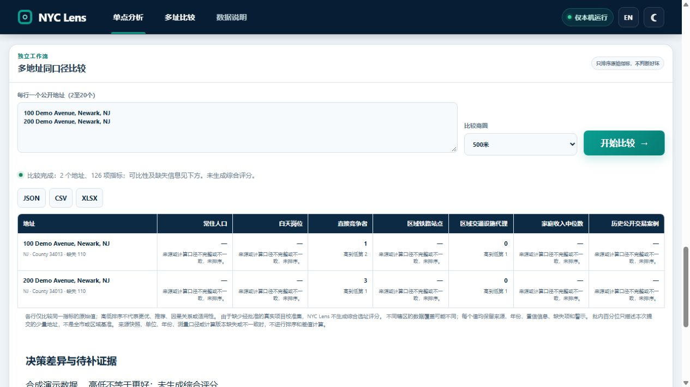
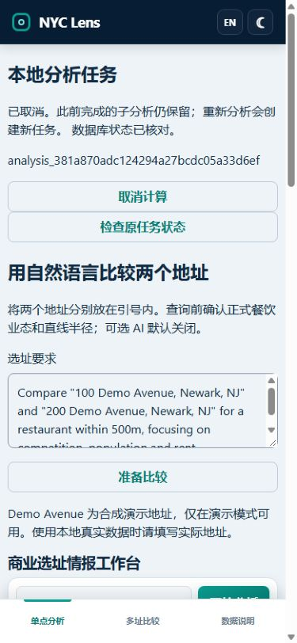

# Bounded interactive analysis — 2026-10-30

This is an unreleased continuation of the failure-isolation work. It changes execution and recovery, not the statistical method or model. It uses original synthetic records; no real business conclusion, customer outcome or new model-quality improvement is claimed.

This document records the initial Web/MCP worker milestone. The subsequent
[legacy HTTP follow-up](bounded-legacy-http-2026-10-30.md) moves the three
compatibility analysis endpoints onto the same jobs. Its new evidence and
remaining CLI/library limits are reported separately.

## Run and scope

Install the existing extras with `pip install -e ".[dev,agent]"`. Run `python -m nyc_lens.demo --port 8766` for a disposable synthetic Web application, or use the existing configured local data home and `nyc-lens serve --host 127.0.0.1 --port 8765`. Keep this local application on loopback. `nyc-lens-mcp` retains the stdio entry point and existing SDK pin; no new service or dependency is required. AI interpretation remains disabled unless explicitly configured and consented.

The natural-language confirmation, single-site form and comparison form now use saved analysis jobs. MCP `analyze_address` and `compare_addresses` use the same bounded worker. The compatibility endpoints `/api/site-analysis`, `/api/site-comparison`, `/api/assistant/compare`, direct Python/CLI calls, ingestion and export still execute directly in this stage. They participate in database admission through `db_session`, but do **not** inherit the new worker's time/memory guard. Migrate callers to the job endpoints before relying on those bounds. Completing coverage of these older routes remains follow-up work.

## Limits and platform meaning

| Boundary | Default | Meaning |
| --- | --- | --- |
| Worker wall deadline | 120 seconds | Starts before worker launch; cancellation/deadline terminates the owned worker and waits for exit |
| Windows process memory | 2048 MiB | Job Object committed-memory budget across associated processes; not a measured RSS budget |
| Linux process memory | 2048 MiB | `RLIMIT_AS` virtual address-space limit per process; not an aggregate cgroup or RSS limit |
| DuckDB buffer | 512 MiB | Separate from the OS limit, leaving room for Python, Arrow and geometry libraries |
| DuckDB query threads | 2 | Per isolated worker instance |
| DuckDB temporary spill | 1024 MiB | Dedicated owned directory; no claim of a whole-database disk quota |
| HTTP job input / private envelope | 256 KiB each | HTTP input is bounded before JSON parsing; structured field limits also apply |
| Stored worker result | 8 MiB | Checked before storing a site/comparison JSON result |
| Saved task population | 2000 per home/database namespace | New tasks stop at capacity; operator archival is required, not silent history deletion |

These are trusted application policy values, not tool/model-selected arguments. No arbitrary SQL, command, script, provider or file path is accepted by the public job schema. Windows installs the Job Object before releasing the child's start gate and uses kill-on-close; failed assignment cleans up the waiting child. Linux sets resource limits and a parent-death signal before importing the analysis engine, and terminates the owned process group on normal supervised completion/cancellation. Linux descendant and memory semantics differ from Windows; a root-process exit is not a measurement of every descendant's RSS. Other platforms return `RESOURCE_GUARD_UNAVAILABLE` rather than silently running the new job unbounded. macOS bounded analysis remains unsupported.

The deadline bounds the worker, not all subsequent database recovery or HTTP/report operations. Full-catalog performance under these defaults is unmeasured. Increasing a limit without a measured workload is not acceptance of the 17 GB data configuration.

## Lifecycle and data ownership

1. Validate the confirmed request, reserve site/comparison IDs, and persist the attempt before computation. The journal contains IDs and a request hash, not addresses or original requirements.
2. Admit one operation per database using an OS file lock. Concurrent Web/MCP reads or writes receive a readable busy result instead of opening DuckDB across an active writer process. Unmanaged external DuckDB clients and Parquet writers are outside this admission mechanism.
3. Run the unchanged analysis engine in the worker. Its private identity pool prevents an unexpected additional analysis from creating untracked IDs. A success receipt must agree with the expected saved result, child IDs and confirmed assistant request.
4. Return success only after worker exit and reading the saved result. On cancellation/deadline, reconcile only reserved `RUNNING` rows after the worker stops. Keep completed child analyses and partial audit records. Cancellation is not rollback.
5. Refresh reconnects to the same job; it does not start a new calculation. If the supervisor disappears, recovery acquires the released job lease and database admission, marks only its interrupted IDs, and never kills a persisted PID or retries automatically. The recovery receipt explicitly says process exit was not observed; database reconciliation is recorded separately. A completed child or comparison saved just before a crash stays stored even when delivery was interrupted.

`RUNNING → CANCELLING → CANCELLED` is distinct from `SUCCEEDED`, `TIMED_OUT`, `FAILED` and `INTERRUPTED`. A cancellation arriving after completion leaves success intact. A failed database reconciliation remains unconfirmed. Do not treat a disconnected browser or a cancellation request as proof that work stopped.

Job receipts live in `NYC_LENS_HOME/data/cache/analysis-jobs/<database-namespace>/`. Worker exchange files live in individually owned `data/cache/analysis-workers/owned-*` directories and are removed only after observed worker exit. Interrupted/uncertain cleanup can retain these local inputs for diagnosis; do not publish them. OS lock files remain as stable lock inodes and must not be deleted while the service is active. Changing process environment requires restarting the service. Browser storage remembers only the latest job ID/operation; clearing storage loses that shortcut, not the server result.

## HTTP and client operation

`POST /api/analysis-jobs` takes `{operation, request, request_id}`. Operations are `site`, `comparison` and `assistant_comparison`; the last requires the existing explicit confirmation contract. `request_id` is 32 lowercase hexadecimal characters. Repeating the same identifier and normalized request returns the same job. Reusing it for different input is rejected. Job paths use the returned `analysis_<request_id>` ID:

- `GET /api/analysis-jobs/{job_id}` returns status, saved states and resource/cleanup receipt.
- `POST /api/analysis-jobs/{job_id}/cancel` requests cancellation; continue checking status.
- `GET /api/analysis-jobs/{job_id}/result` returns only a successful saved result. Existing evidence/report URLs remain unchanged.

The page offers Cancel and Check original task status. Closing the page leaves bounded server computation running. Connection uncertainty preserves the original ID; it does not issue a replacement request. MCP cancellation uses a marker and waits for worker cleanup within its shielded shutdown window; the durable receipt remains authoritative if the transport disconnects. No additional real Hermes/model run was made for this change.

## Evidence and limitations

Native Windows / Python 3.11 / DuckDB 1.5.6 were used locally. Fourteen process contracts were frozen at `c48df01` before the supervisor existed: 14 failures became 14 passes with unchanged assertions. A separate frozen guard-assignment failure at `9f48a4f` exposed a waiting-child leak; it passed after cleanup was repaired. A real parent-exit test also confirms Windows kills the associated worker. The allocation test asks for 512 MiB inside a 96 MiB Job, exercising OS refusal without allocating that amount successfully.

Thirteen real synthetic worker checks cover preserved 1/3 competitor counts, source/report/calculation identity, effective DuckDB budgets, invalid input, precancel, actual long-query cancellation/deadline, completed-child retention, unrelated-attempt isolation and manual retry. The first two test attempts had incomplete fixture inserts (required catchment, snapshot and calculation columns); both failures remain in the local logs. Correcting setup did not change any expected outcome. The resulting set passed in 29.41 seconds. Nineteen existing assistant/configuration/interruption/error checks passed in 37.87 seconds. Five durable-job tests and three existing UI checks passed in 22.66 seconds before the additional oversized-body test. The complete local suite at code commit `0eff80ee05a8e33f0371b9c4b549e50b042af71f` passed **162 tests, with 3 full-data skips and 160 deprecation warnings, in 110.69 seconds**; three JavaScript syntax checks also passed. Later changes in this milestone only add CI and evidence documentation. [Machine-readable receipt](../evaluations/bounded-analysis-2026-10-30.json) separates this from hosted checks and live Hermes acceptance.

Actual in-app browser interaction used an isolated normal synthetic server: English preparation, confirmation, refresh to the same ID, restored map/addresses, Chinese differences and missingness, and JSON download. The downloaded report retained 1/3 values, synthetic labeling and no composite score. A separate explicitly instrumented synthetic server held the second site's real SQL query; refresh and the page's Cancel button stopped it and retained the first completed site. This is automatic browser simulation, not an independent participant. Desktop and 390×844 viewport layouts were inspected; this is not physical-device acceptance. A startup connection-refused error occurred before the first server was ready; testing continued in a fresh temporary tab once startup completed.

Still open: full-data execution/freshness, atomic dataset generations and external writer coordination, macOS resource guarding, migration of direct compatibility routes, whole-database/report disk quotas, independent users and a fresh real Hermes acceptance of this worker route. Prior model/client evidence is historical and is not relabeled as this version's acceptance. Composite scoring remains disabled.

## Rollback and release

No schema migration, production deployment, paid service, default-branch merge or release is performed. Before rollback, request cancellation, wait for terminal receipts and stop the service. Preserve the database, configuration, evidence files and task journals. Revert this branch's changes or restore the prior code checkout; existing successful site/comparison/report schemas remain readable. The prior code does not offer the new job controls or resource guard and will not manage these journals. Do not delete records to make an interrupted task look successful.

## Primary references checked 2026-10-30

- [Microsoft Job Objects](https://learn.microsoft.com/en-us/windows/win32/procthread/job-objects): grouped process limits, inherited association, termination and kill-on-close. Native tests, not this reference alone, establish local behavior.
- [Python 3.11 resource limits](https://docs.python.org/3.11/library/resource.html): platform-dependent limits and `RLIMIT_AS` address-space semantics.
- [Linux parent-death signal](https://man7.org/linux/man-pages/man2/PR_SET_PDEATHSIG.2const.html): parent-thread semantics and the need to check the parent after setting the signal.
- [DuckDB Python connection configuration](https://duckdb.org/docs/stable/clients/python/overview): independent connection configuration. Effective buffer/thread/spill settings are read back from the actual child connection in the tests; no claim is based on changing a version string.
