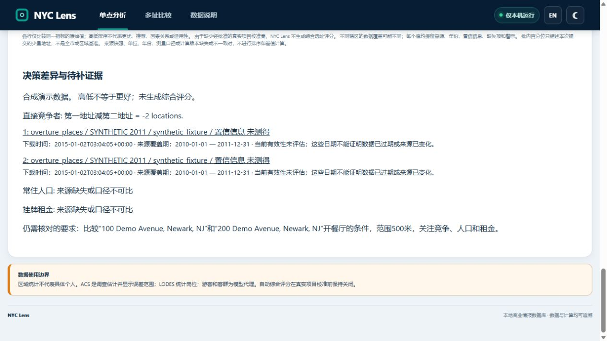

# Comparison scenarios and saved source observations

Observed on 2026-10-31 America/New_York (some receipts use 2026-11-01 UTC). This milestone builds on the FEMA/publication work in PR #14. It does not change source coverage, calculation formulas, scoring approval, dependencies or production data.

## Behavior

An ambiguous Census response previously selected its first match. New lookups require exactly one match, preserve the entire response and ask for a more specific address when several locations match. Legacy Census cache entries are checked against their hash-verified full response; a known ambiguous response is not reused or silently retried. A missing or unverifiable legacy receipt requires a new official lookup. Existing address history is retained. The synthetic demo's existing analysis guard still allows only its seeded addresses and radial scopes.

Each new metric result now saves `source_observation`: the observation time, snapshot retrieval time, retrieval age at analysis, source reference period, vintage and snapshot status. Comparisons and JSON/CSV/XLSX reports use those saved values. Single-site HTML and tabular reports also include the dates. Editing the current source catalog cannot rewrite a saved result's observation. Synthetic metrics preserve the fixture vintage instead of always being relabeled 2026.

`valid_from` and `valid_to` are presented as **source reference dates**, not expiry dates. Retrieval age is not proof of a new upstream version, an expired tariff or current applicability. `currentness` remains `NOT_ASSESSED`; this milestone introduces no arbitrary freshness cutoff. Missing and mismatched snapshot metadata remain explicit, and a future retrieval timestamp has unknown age plus a warning. Old results are not backfilled from today's catalog: their exports say `NOT_RECORDED` and the UI explains that their dates were not saved.

## Frozen comparison

The [twelve-task catalog](../tests/fixtures/comparison_acceptance_20261031.json) and [assertions](../tests/unit/test_comparison_acceptance_scenarios.py) were committed before implementation (`d5ef9b1`). They are unchanged after the fix. All addresses, businesses, source dates and records in these tasks are synthetic.

| Task | Verification boundary | Before | After |
|---|---|---|---|
| English requirements, confirmation, two sites, map geometry, evidence and three exports | HTTP with real owned worker and spatial/report engine | Pass | Pass |
| Chinese equivalent with missing population and rent | HTTP with real owned worker and engine | Pass | Pass |
| One address | Interpretation; no analysis created | Pass | Pass |
| Duplicate addresses | Interpretation; no analysis created | Pass | Pass |
| Three alternatives requiring a choice of two | Interpretation; no silent first-two selection | Pass | Pass |
| Unsupported coffee-shop business type | Interpretation; no invented restaurant rules | Pass | Pass |
| Walking requirement followed by explicit radial confirmation | Real engine; unmet walking requirement retained | Pass | Pass |
| Two official-format geocoder matches | Real adapter, synthetic HTTP transport; no live Census call | Fail: selected first | Pass |
| Failed source | Real engine; missing remains missing, not zero | Pass | Pass |
| Old retrieval and reference period | Real engine; dates and original synthetic vintage retained | Fail: dates absent | Pass |
| Similar values with different units | Comparator/decision-brief contract; not a full browser task | Pass | Pass |
| Catalog changes after a result is saved | Real engine and JSON/CSV/XLSX; saved dates stay fixed | Fail: dates absent | Pass |

Before: **9 passed, 3 failed, 130.37 s**. After: **12 passed, 114.89 s**. These timings were observed under different concurrent workloads and do not establish a speed improvement. Another **66 related checks passed** in 186.08 s, with 15 existing Shapely deprecation warnings; they cover legacy geocoder caches, missing/future source observations, comparison boundaries, reports, configuration, Web contracts and MCP business-flow tests. JavaScript syntax checks passed. The complete new-runtime suite is separately recorded; a related subset is not a full-suite result.

The [verification receipt and portable original logs](../reports/evaluations/2026-10-31/comparison-scenarios/verification.json) identify the base, frozen tests, runtime, file hashes and outstanding checks. The original three failures are retained. Existing full-data skips and the earlier PR #14 MCP cleanup failure remain in their original records; later passes do not explain that earlier failure.

## Actual browser observation

The in-app browser completed separate English and Chinese requests against the real local HTTP service and bounded worker. The AI provider was disabled. Both required confirmation, produced the synthetic values 1 and 3, retained missing population/rent, showed two map markers and evidence links, and offered JSON/CSV/XLSX. Refresh restored the same completed task instead of creating another analysis. A browser-downloaded XLSX contained 252 metric/site rows and the expected saved retrieval/reference dates.



The comparison map currently displays the two locations. Catchment polygons are available through each saved site's API; displaying both polygons together in the comparison map remains follow-up work. The [map observation](../reports/evaluations/2026-10-31/comparison-scenarios/map.jpg) retains the synthetic label and basemap attribution.

A 390 × 640 CSS-pixel iframe viewport displayed the actual application and restored result. Text reflow and source dates were inspected. The browser tool could not reliably click buttons inside this embedded viewport, so this is **narrow-screen display inspection only**, not complete mobile interaction, physical-device or independent-user acceptance. Initial browser navigation also occurred before local startup completed and failed; a later navigation after readiness succeeded. Those tool/startup observations are not hidden as successful interactions.

## Run and configuration

Use the existing supported Python environment and install `pip install -e ".[dev,agent]"`. For a new isolated demo, leave `NYC_LENS_HOME` and `NYC_LENS_DATABASE` unset and run:

```text
python -m nyc_lens.demo --port 8766
```

Use the two quoted Demo Avenue addresses shown on the page, choose the supported full-service restaurant type and explicitly confirm the radial scope. The default fixture uses its 2026 vintage; the historical 2011/2015 dates above belong only to the dated acceptance fixture, not real local data. No new environment variables, model credentials or cloud processing are required. AI interpretation remains optional under the existing explicit provider/data-sharing configuration. Hermes/client and live-model observations remain documented separately in the [natural-language integration record](natural-language-comparison-2026-10-27.md).

To reproduce the frozen and supplementary checks:

```text
python -m pytest tests/unit/test_comparison_acceptance_scenarios.py tests/unit/test_source_observation.py tests/unit/test_geocoding_ambiguity.py
```

## Compatibility, rollback and remaining acceptance

- No database migration or deployment was performed. Saved JSON gains additive observation fields, and CSV/XLSX gain seven columns. Consumers that assume an exact positional column count must use named headers or review this additive change.
- Earlier saved results keep their original data. Restoring the prior application checkout retains those results and the source catalog. It also restores the older ambiguous-address behavior; do not reuse known ambiguous caches without review. No history deletion, source-record rewrite or fabricated match approval is part of rollback.
- Source dates do not establish currentness; upstream change detection and source-specific applicability policies remain separate work.
- No new model call was made and no AI quality/cost advantage is claimed. Twelve tasks are not twelve independent users or a broad natural-language benchmark.
- Complete regional data, a full real-location comparison, comparison catchment overlays, independent first-use testing, physical/mobile interaction and MCP Apps rendering remain outside this milestone's verified scope. Production publication still requires its separate review.
